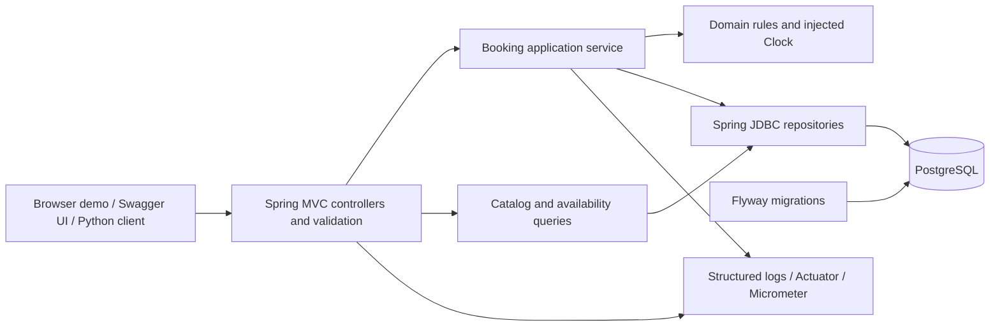
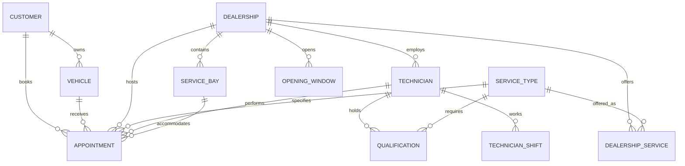
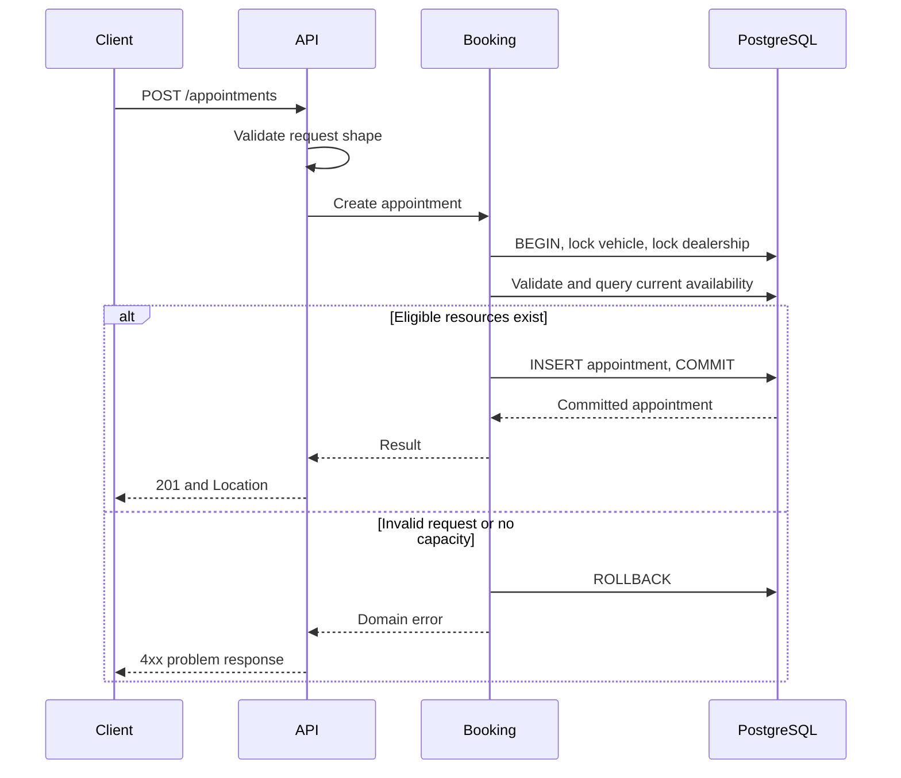

# Unified Service Scheduler — System Design

**Assessment:** Keyloop, Scenario A (Ownership)  
**Implementation layer:** Backend; client represented by an API contract and demo requests  
**Selected stack:** Java, Spring Boot, PostgreSQL  
**Document date:** 2026-11-01; finalized against implementation on 2026-11-03

**Status:** Final implemented P0 architecture through M6, reviewed for M7 documentation, with a subsequent Swagger UI and guided browser harness extension. P1 benchmarking and remaining P2 features are deferred. Video preparation is documented separately; a script is not a recorded submission.

## 1. Purpose and assessment alignment

Build a REST API that confirms a vehicle service appointment only when one service bay and one qualified technician are available at the selected dealership for the entire service duration. Persist the confirmed allocation, including the customer and vehicle.

The source is the supplied **KeyloopCodingChallange.pdf**, Scenario A on pages 1–2, challenge structure on page 3, and deliverables/evaluation on page 4. The assessment permits reasonable documented assumptions and requires implementation of one service layer. This document treats the source as requirements for the submission, not as instructions to perform unrelated actions.

| ID | Explicit assessment requirement | Implementation / deliverable evidence |
|---|---|---|
| R1 | Request a service for a specific vehicle, service type, dealership and desired time | POST appointment contract; HttpContractIT availability/create/read flow ([M5](m5-results.md)) |
| R2 | Check a bay and a qualified technician for the entire service duration before confirmation | AvailabilityRulesIT, BookingTransactionIT and direct exclusion tests ([M3](m3-results.md), [M4](m4-results.md)) |
| R3 | Persist an appointment associating customer, vehicle, technician and bay | V1 constraints, create/read tests and packaged restart/recovery scenario ([M2](m2-results.md), [M6](m6-results.md)) |
| R4 | Backend exposes REST and uses persistent storage; client can be stubbed | Eight Spring MVC operations, PostgreSQL volume, [OpenAPI](openapi.yaml) and Python HTTP demo client |
| R5 | Explain architecture, components, data flow, technology and observability | Sections 4–10 |
| R6 | Explain use of GenAI in design and verification | Section 13, README AI Collaboration Narrative and milestone evidence |
| R7 | Runnable repository with build/run/test instructions and core business tests | [README](../README.md), Maven Wrapper, real PostgreSQL tests and operational runbook |

Double-booking protection, operational calendars and vehicle ownership checks are design decisions supporting correctness. They are not additional features explicitly enumerated by the assessment.

## 2. Scope

### Implemented in the P0 baseline

- Seeded customers, vehicles, dealerships, offered services, bays, technician qualifications and dated working windows.
- Read-only discovery of dealerships, services, customers and customer vehicles for the demo.
- Check availability for one exact requested start time.
- Automatically select one eligible bay and technician and create a confirmed appointment atomically.
- Retrieve an appointment by ID and list appointments for a customer/vehicle with pagination.
- Database migrations, automated tests, predictable errors, logs, metrics and local operational instructions.
- Static OpenAPI contract and reproducible demo requests; no complete frontend.

### Deferred

Authentication/authorization, admin CRUD, cancellation/rescheduling, notifications, payments, recurring booking, temporary holds, calendar UI, alternative-slot search, bay-specific equipment, multi-technician services, travel between dealerships and distributed deployment infrastructure.

Idempotency keys and trace export are optional follow-up work. Their absence and consequences are documented below. P1 performance measurement is also deferred; the proposed workload in section 8 is not an executed benchmark.

## 3. Assumptions and business rules

| ID | Decision | Consequence |
|---|---|---|
| A1 | One appointment requires exactly one bay and one technician continuously | Resources cannot be swapped halfway through a service |
| A2 | Each service type has a fixed positive integer duration in minutes | The server calculates the end time; the client cannot override it |
| A3 | All active bays support every service offered by their dealership | No bay/service compatibility matrix in the baseline |
| A4 | A technician belongs to one dealership and has explicit service qualifications | Both membership and qualification must match |
| A5 | The system assigns resources, ordered by stable IDs | Deterministic behavior; fair workload distribution is deferred |
| A6 | A vehicle belongs to one customer; reference data is read-only during operation | Ownership is validated; transfers and qualification/calendar edits have no public API |
| A7 | A vehicle cannot have overlapping appointments, including at different dealerships | Vehicle is also a constrained resource |
| A8 | Appointments use half-open intervals `[start, end)` | A booking ending at 10:00 permits another beginning at 10:00 |
| A9 | Appointments must fit wholly inside one dealership opening window and one technician shift | Splitting across lunch breaks or separate windows is rejected |
| A10 | The start must be strictly in the future and no later than `now + 30 days` as elapsed time | Inject a Clock; validate again after waiting for locks |
| A11 | Input uses RFC 3339 timestamps with `Z` or an explicit offset, at whole-minute precision | Reject naive local times and nonzero seconds/fractions |
| A12 | Store instants as PostgreSQL `timestamptz`; return UTC timestamps and dealership IANA timezone separately | The original submitted offset is not preserved |
| A13 | Opening windows and shifts are dated absolute intervals | Recurrence, daylight-saving calendar generation and holiday management are deferred |
| A14 | No configured opening window means the dealership is closed; no shift means the technician is unavailable | Demo seed covers at least the next 45 local dates; runtime does not invent missing shifts |
| A15 | Only confirmed appointments are stored in the baseline | Failed requests create no appointment or reservation rows |
| A16 | Demo is local, with synthetic data and no authenticated actor | Customer ID identifies an entity, not proof of permission |

Seed examples use `Asia/Ho_Chi_Minh`, but comparison logic uses instants. Other IANA zones may be stored; supplied shift instants resolve any daylight-saving ambiguity before the booking path. Booking duration is elapsed minutes, not local wall-clock arithmetic.

For intervals A and B, overlap means `A.start < B.end AND B.start < A.end`. Positive duration and non-null finite endpoints are mandatory. Identical, partially overlapping and fully enclosing intervals conflict.

## 4. Architecture and technology

The implementation is a modular monolith: one deployable Spring Boot application and one PostgreSQL database. Booking has a single transaction boundary; independent microservices would add coordination without helping the assessment scope.



| Choice | Purpose and reason |
|---|---|
| Java 21 | Explicit Java baseline; records for DTOs, `java.time` for temporal values |
| Spring Boot 4.1.2 | Pinned parent in pom.xml; built and tested with Java 21. Compatibility reference consulted during design [S1] |
| Spring MVC and Jakarta Validation | Synchronous request handling and boundary validation |
| Spring JDBC (`JdbcClient`/`JdbcTemplate`) | Explicit, parameterized SQL for interval queries and row locks; avoids hiding the central allocation logic behind ORM behavior [S2] |
| Spring transaction management | A single DataSource and transaction manager for all booking reads/writes |
| PostgreSQL 18.1 | Same postgres:18.1 patch tag in Compose and Testcontainers; relational integrity and interval exclusion constraints |
| Flyway | Versioned SQL schema, indexes, extension and constraints; include PostgreSQL database support in the dependency set |
| Maven Wrapper 3.9.11 | Pinned distribution in .mvn/wrapper/maven-wrapper.properties; no host Maven installation required |
| JUnit Jupiter, AssertJ, Spring testing support, Testcontainers | Unit tests and integration tests against real PostgreSQL [S3] |
| Actuator and Micrometer | Health endpoints and metrics; a path to tracing [S4] |
| Docker Compose | Local application/database environment with a persistent database volume |
| OpenAPI 3.1 and Swagger UI 5.34.1 | Canonical contract packaged into the JAR and served to locally bundled interactive documentation |

Spring Boot manages dependency versions; the PostgreSQL driver is available at compile time for typed server-error diagnostics. Compose and tests use the same PostgreSQL patch tag, not a database image digest. The application runtime base is digest-pinned in Dockerfile. Maven 3.9.11 and the dependency set were resolved and tested; milestone reports record actual environments and cache use. This is version pinning, not a claim of byte-identical builds.

### Package responsibilities

Actual root package: `com.keyloop.scheduler`.

- `api`: SchedulerController, API DTOs, canonical UUID parsing, problem responses and request correlation.
- `appointment`: BookingService, transaction failure mapping, appointment record, persistence and history queries.
- `availability`: reference validation, complete-interval resource queries and shared candidate/result/reason types.
- `catalog`: read-only customers, vehicles, dealerships and services.
- `shared`: BookingTimePolicy, ServiceInterval, Page and BusinessException.
- `config`: replaceable UTC Clock wiring. Database, health, metrics and logging settings live in application.yaml.

Opening windows and shifts are queried by AvailabilityRepository; no separate schedule package was needed. HTTP DTOs remain separate from persistence records. SQL stays in concrete repositories, and policy stays in application/domain code; there is no generic CRUD framework or unnecessary repository-interface layer.

## 5. Logical data model

IDs are UUIDs. Mandatory appointment fields are `NOT NULL`; timestamps are finite. Reference entities are seeded and read-only. Hard deletion of referenced records is restricted.

| Table | Important columns / keys |
|---|---|
| `customers` | `id`, `display_name` |
| `vehicles` | `id`, `customer_id`, unique `vin`, `make`, `model`; unique `(id, customer_id)` |
| `dealerships` | `id`, `name`, `time_zone`, `active` |
| `service_types` | `id`, `name`, `duration_minutes > 0`, `active` |
| `dealership_services` | Composite PK `(dealership_id, service_type_id)` |
| `service_bays` | `id`, `dealership_id`, `name`, `active`; unique `(id, dealership_id)` |
| `technicians` | `id`, `dealership_id`, `display_name`, `active`; unique `(id, dealership_id)` |
| `technician_qualifications` | Composite PK `(technician_id, service_type_id)` |
| `dealership_opening_windows` | `id`, `dealership_id`, `starts_at`, `ends_at`; positive interval |
| `technician_shifts` | `id`, `technician_id`, `starts_at`, `ends_at`; positive interval |
| `appointments` | `id`, `customer_id`, `vehicle_id`, `dealership_id`, `service_type_id`, `technician_id`, `service_bay_id`, `starts_at`, `ends_at`, `duration_minutes`, `status`, `created_at` |



### Integrity and history

- Composite foreign keys on appointments enforce `(vehicle_id, customer_id)`, `(service_bay_id, dealership_id)` and `(technician_id, dealership_id)` membership.
- Composite foreign keys enforce `(dealership_id, service_type_id)` being offered and `(technician_id, service_type_id)` being qualified.
- `duration_minutes` is a snapshot. Check that it is positive and `ends_at = starts_at + duration_minutes * interval '1 minute'`.
- Baseline status is restricted to `CONFIRMED`; there is no update/delete endpoint. A future cancellation migration must update both the status constraint and overlap rules deliberately.
- Three named GiST exclusion constraints reject overlapping `tstzrange(starts_at, ends_at, '[)')` for the same bay, technician or vehicle. Enable `btree_gist` for UUID equality. PostgreSQL documents this combination for non-overlapping resource reservations [S5].
- Active flags, opening/shift containment, future time and booking horizon are service-level checks. Foreign keys and exclusion constraints do not enforce these policies.
- Qualifications, service offers and ownership cannot be changed casually while historical foreign keys reference them. Future administration requires effective-dated records or historical snapshots; it is outside this baseline.

The single appointment row reserves both resources atomically. There is no separate allocation row that could be committed without its appointment.

### Implemented M2 database baseline

V1 creates the tables and named constraints described here. Demo data is loaded explicitly with `scripts/demo/seed.sh`; it is outside Flyway migrations and application startup. Window IDs use dealership IDs and absolute epoch values, independent of session timezone or date formatting. Seed adds missing records and preserves appointments. See [M2 results](m2-results.md) for verified constraints, calendar coverage and remaining service-level rules.

### Indexes

The exclusion constraints supply GiST indexes for overlap checks. V1 adds B-tree indexes for dealership bay/technician membership, service qualification lookup and appointment history `(customer_id, starts_at, id)` and `(vehicle_id, starts_at, id)`. Opening-window and shift uniqueness constraints already index owner/start/end, so duplicate indexes are omitted. Candidate resources are selected in SQL rather than fetching all appointments into Java. Query-plan tuning on the proposed representative workload remains unmeasured.

## 6. Availability and booking consistency

### Availability semantics

`GET /api/v1/availability` checks one exact interval, including the vehicle, offered service, opening window, qualified on-shift technician and bay. Use one SQL statement for the final candidate/conflict evaluation so the result has one statement snapshot. Reference data is immutable in the running baseline.

Return a boolean, calculated end time, `checkedAt` and a reason when unavailable. Do not promise specific resource IDs or hold resources. A true result is advisory; a later POST may fail because another request booked first. No availability cache, read replica or WebSocket is required.

### Implemented M3 service baseline

AvailabilityService and AvailabilityRepository implement the reference checks and single-statement resource assessment described above. Shared BookingTimePolicy, ServiceInterval and Page types implement temporal and pagination rules. CatalogService delegates discovery SQL to CatalogRepository. Public availability is advisory and exposes no resource IDs; booking uses the internal candidate assessment after acquiring its locks. M5 now wires these services through separate HTTP DTOs and controllers. See [M3 results](m3-results.md) for real PostgreSQL verification and the timestamp-precision correction.

### Booking transaction

Use PostgreSQL `READ COMMITTED` and acquire row locks in this order for every booking path:

1. Lock the vehicle row by ID with `SELECT ... FOR UPDATE`; validate all reference existence before ownership and bookability, preserving 404 before 422 precedence.
2. Lock the requested dealership row with `SELECT ... FOR UPDATE`.
3. In subsequent statements, re-read the current time, validate reference data and operational windows, and query appointment conflicts/candidates.
4. Choose the lowest-ID available active bay and the lowest-ID available active qualified technician whose shift contains the full interval. Because all bays support all offered services, independent selection of these two candidates is sufficient.
5. Insert one confirmed appointment with the computed end time and duration snapshot.
6. Commit before returning `201 Created`.

All booking queries execute on the same transaction-bound connection. The Spring-managed BookingService explicitly owns a TransactionTemplate with READ_COMMITTED and REQUIRES_NEW; this boundary does not rely on @Transactional proxy interception. A caller transaction cannot later undo the independently committed booking. No external service calls run inside the transaction.

The vehicle lock serializes bookings of the same vehicle across dealerships. The dealership lock serializes allocations at one dealership, so a waiting request sees the committed booking before selecting remaining resources. PostgreSQL row locks last until the transaction ends [S6]. Under Read Committed, subsequent statements obtain fresh snapshots; **the availability query must run after the lock-acquisition statement**, not as part of a pre-lock snapshot [S7].

This design deliberately trades per-dealership write throughput for a small, auditable allocation algorithm. Different dealerships with different vehicles can book concurrently. The exclusion constraints also protect the three overlap invariants if a future writer accidentally bypasses the application lock protocol.



### Failure handling

- Insufficient resources or existing vehicle booking: rollback and return `409`.
- Recognized overlap constraint violation: rollback and map the named constraint to a domain conflict. Do not continue querying inside an aborted transaction.
- Unexpected integrity failures: return `500` and a correlated, sanitized failure outcome; do not log raw SQL exceptions or label every database error as unavailable capacity.
- Lock/statement timeout, deadlock or temporary database unavailability: rollback and return `503`. No unbounded retries and no automatic POST retries in the baseline.
- Implemented default booking budgets: lock timeout 2 seconds, statement timeout 3 seconds and transaction timeout 5 seconds. Hikari acquisition/connect/socket limits are 2/2/5 seconds, with 1-second connection validation. Real lock and statement timeout tests prove controlled rollback. These settings do not establish a universal hard HTTP deadline; the previously proposed 10-second HTTP budget is not implemented. Load-based tuning is deferred.
- A successful database commit followed by a lost HTTP response has an ambiguous client outcome. The client should query appointment history before retrying. Baseline duplicate submissions produce a vehicle conflict, not an idempotent replay response. Durable idempotency keys are a follow-up feature.

Every code path that writes bookings must follow vehicle-then-dealership lock order. Future bulk booking or schedule-edit paths need their own ordered locking analysis. Database constraints are the final overlap safety net, not a substitute for all business validation.

### Implemented M4 transaction baseline

BookingService uses a Spring TransactionTemplate with READ_COMMITTED and REQUIRES_NEW, so it owns commit before returning success even when a caller has an existing transaction. That caller cannot later roll back the independently committed booking. AppointmentRepository locks vehicle then dealership, reuses reference validation and runs a fresh availability/time assessment before insert. Success metrics/logging occur after commit. Structured PostgreSQL constraint diagnostics distinguish known conflicts from unexpected errors. See [M4 results](m4-results.md) for actual contention, rollback, timeout and ambient-transaction tests. M5 now maps these outcomes to HTTP and verifies them on a real server.

## 7. API contract

The browser extension serves `/demo/index.html`, `/swagger-ui/index.html` and `/openapi.yaml`. Swagger uses the canonical packaged contract (version 0.2.1), with a relative `/api/v1` server and three operation tags. The small static demo harness uses existing APIs only; it adds no migration, resource-assignment logic or booking endpoint. Both browser pages use the same origin; Swagger assets and licenses are packaged locally. The original Python client remains available.

Prefix: `/api/v1`. JSON field names use camelCase. Return UTC timestamps with `Z`. UUIDs identify resources. Reject unknown write fields such as a caller-supplied `endsAt`, `technicianId` or `serviceBayId`.

| Method and path | Purpose | Success |
|---|---|---|
| `GET /dealerships` | List active dealerships | 200 |
| `GET /dealerships/{id}/services` | List active offered services and durations | 200 |
| `GET /customers` | Demo customer discovery | 200 |
| `GET /customers/{id}/vehicles` | Discover a customer's vehicles | 200 |
| `GET /availability` | Check exact interval for all five booking inputs | 200, including unavailable results |
| `POST /appointments` | Allocate resources and persist | 201 plus `Location` |
| `GET /appointments/{id}` | Retrieve confirmed appointment | 200 |
| `GET /appointments?customerId=...&vehicleId=...` | History/recovery after uncertain response; customer required, vehicle optional | 200 |

List endpoints use `page` (zero-based, default 0) and `size` (default 20, maximum 100), with an `items`, `page`, `size`, `totalElements` envelope. Use stable ID ordering for catalogs and `(startsAt, id)` ordering for history. An empty list is 200; an unknown parent resource is 404.

Availability query fields are `customerId`, `vehicleId`, `dealershipId`, `serviceTypeId`, `startsAt`; they match the POST input. URL-encode the `+` in a positive timestamp offset, or use UTC `Z`.

### Contract clarifications

The machine-readable contract is [OpenAPI 3.1](openapi.yaml), version 0.2.1, covering eight operations. These clarifications settle previously unspecified details without changing booking rules:

- Catalog ordering is ID ascending; history is `startsAt` ascending, then ID ascending. Out-of-range pages return an empty 200 page.
- History validates customer and optional vehicle existence (404); an existing vehicle belonging to another customer returns 422 `VEHICLE_CUSTOMER_MISMATCH`.
- An existing inactive dealership returns 422 `SERVICE_NOT_BOOKABLE` for service discovery, booking and availability; a missing dealership remains 404.
- A supplied request ID is reused only when it contains 1–128 ASCII letters, digits, dots, underscores or hyphens. Otherwise generate a UUID; do not reject an otherwise valid request because its correlation token is invalid. Return `X-Request-ID` on all responses.
- Timestamp syntax/offset failures return 400. Syntactically valid timestamps with nonzero seconds/fractions return 422, so the OpenAPI input format intentionally does not enforce whole-minute precision as a structural pattern.
- `available: true` requires `reason: null`; `available: false` requires one of the four documented resource reasons. No resource IDs are promised by availability.
- The API is implemented and HTTP-tested in M5. Examples use illustrative dates and must not become fixed demo dates; the demo client selects future times dynamically.

### Implemented M5 HTTP baseline

Separate API DTOs expose UTC strings and strict canonical UUID input. Controllers delegate to the existing services without adding a surrounding booking transaction. Problem responses and request-ID correlation are implemented for successes and errors. Standard 405/406/415 responses retain HTTP semantics with INVALID_REQUEST, and 405 includes Allow; OpenAPI includes these protocol statuses and default error responses. Appointment retrieval/history supports post-commit recovery. See [M5 results](m5-results.md) for 27 real HTTP tests, captured-response schema validation and the packaged demo.

### Request and response examples

The following IDs and dates illustrate the contract, not existing records. The executable demo uses seeded IDs and a dynamically selected future date.

```json
{
  "customerId": "00000000-0000-4000-8000-000000000001",
  "vehicleId": "00000000-0000-4000-8000-000000000002",
  "dealershipId": "00000000-0000-4000-8000-000000000003",
  "serviceTypeId": "00000000-0000-4000-8000-000000000004",
  "startsAt": "2026-11-10T09:00:00+07:00"
}
```

Example availability response for a 60-minute service:

```json
{
  "available": true,
  "startsAt": "2026-11-10T02:00:00Z",
  "endsAt": "2026-11-10T03:00:00Z",
  "durationMinutes": 60,
  "dealershipTimeZone": "Asia/Ho_Chi_Minh",
  "checkedAt": "2026-11-01T14:00:00Z",
  "reason": null
}
```

Successful POST and GET-by-ID return `id`, `customerId`, `vehicleId`, `dealershipId`, `serviceTypeId`, assigned `technicianId` and `serviceBayId`, `startsAt`, `endsAt`, `durationMinutes`, `dealershipTimeZone`, `status: CONFIRMED`, and `createdAt`.

### Validation and error mapping

Use `application/problem+json` with `type`, `title`, `status`, `detail`, `instance`, a stable `code`, and `requestId`; optional `errors` identifies invalid fields. Do not return SQL, stack traces or credentials.

| Condition | HTTP/code for POST | Availability behavior |
|---|---|---|
| Invalid JSON/UUID/timestamp, unknown field, invalid pagination | 400 `INVALID_REQUEST` | Same |
| Customer/vehicle/dealership/service ID missing from database | 404 `RESOURCE_NOT_FOUND` | Same |
| Vehicle not owned by customer | 422 `VEHICLE_CUSTOMER_MISMATCH` | Same |
| Inactive dealership/service or service not offered | 422 `SERVICE_NOT_BOOKABLE` | Same |
| Past start, invalid precision or beyond horizon | 422 `INVALID_BOOKING_TIME` | Same; malformed timestamps remain 400 |
| Interval outside opening window | 409 `OUTSIDE_OPENING_HOURS` | 200, `available: false`, same reason |
| Vehicle has overlapping appointment | 409 `VEHICLE_UNAVAILABLE` | 200, false |
| No active free bay | 409 `NO_AVAILABLE_BAY` | 200, false |
| No active qualified on-shift free technician | 409 `NO_AVAILABLE_TECHNICIAN` | 200, false |
| Named bay/technician exclusion constraint conflict | 409 `BOOKING_CONFLICT` | Not applicable to read |
| Named vehicle exclusion constraint conflict | 409 `VEHICLE_UNAVAILABLE` | Not applicable to read |
| Timeout, deadlock or unavailable database | 503 `TEMPORARILY_UNAVAILABLE` | Same |
| Unexpected server/integrity failure | 500 `INTERNAL_ERROR` | Same |

If multiple resource checks fail, report in this order: opening window, vehicle conflict, bay availability, technician availability. Availability and booking share these policies to prevent contradictory outcomes caused by different validation implementations. State changes between the calls can still legitimately change the answer.

## 8. Reliability, performance and evolution

**Durability:** PostgreSQL is the source of truth. A named local volume survives application/database restarts. Migration failures stop startup; no in-memory replacement database is silently selected. Backups and restore drills belong to a production deployment plan.

**Consistency:** One transaction inserts the complete appointment. A process failure before commit leaves no booking. A process failure after commit leaves a retrievable booking even if the HTTP response is lost.

**Performance:** Queries filter by dealership, service, interval and active state in SQL, using `NOT EXISTS` overlap checks against indexed appointment ranges. Independent bay/technician candidate selection avoids an O(bays × technicians) Cartesian expansion under A3. The local connection pool is bounded at 10; database/transaction budgets are described in section 6. Pool capacity and latency under load have not been measured.

**Proposed measurement target, not a result:** On a documented machine, with 10 dealerships, 10 bays and 20 technicians per dealership, 10,000 seeded appointments, and 20 mixed requests/second for 60 seconds, target p95 below 500 ms and no unexpected 5xx under steady load. Record the read/write mix (initially 80/20), hardware and database image. Separately stress one dealership to expose lock contention. The correctness gates do not depend on achieving an invented throughput number.

**Scale path:** Multiple stateless API instances can share PostgreSQL and the same lock protocol. The dealership row remains a write bottleneck. When measured contention justifies change, move to finer resource locking or optimistic candidate allocation with bounded retry, preserving database exclusion constraints and the concurrency tests. Do not add Redis locks, caching of authoritative availability, a broker or sharding merely for the assessment.

**Read replicas:** Suitable only for explicitly stale catalog/history views. Booking and authoritative availability continue to use the writer database.

**Production gaps:** Authentication, customer/dealership authorization, rate limiting, TLS, secrets management, calendar administration, backups and idempotency require additional work before exposure to real customers. The submitted baseline is a locally runnable assessment, not a production-readiness claim.

## 9. Observability

Spring Boot integrates observations through Micrometer; the baseline uses structured logging and metrics, while external trace export remains optional [S4].

- Generate or accept a length/character-validated request ID, return it in `X-Request-ID`, and add it to all request logs. Clear logging context after each request.
- Log one final booking outcome after transaction completion with event, outcome, reason, elapsed time, request ID and appointment ID when successful. Never emit a success event before commit.
- Emit sanitized failure type/code and final outcome diagnostics with request ID; omit raw application SQL exceptions, customer names, VINs, request bodies and connection secrets.
- Record `scheduler.booking.requests` for service invocations with bounded outcome/reason tags, `scheduler.booking.duration`, `scheduler.booking.lock.wait` for lock-acquisition SQL duration, and Hikari pool signals. DTO failures before service entry are represented by HTTP metrics/logs. The lock timer includes query/network overhead, not only database lock wait. Do not use customer/vehicle/appointment IDs as metric labels.
- Expose liveness without a database dependency and readiness with database connectivity. Limit local Actuator exposure to health and required metrics; do not expose environment/configuration endpoints.
- Initial investigation signals: elevated 5xx, database readiness failure, increasing lock waits or pool saturation. Capacity-related 409 responses are normal business outcomes; monitor them separately from infrastructure errors.
- Optional tracing: HTTP request → booking operation → database work, with trace IDs in logs. Do not claim JDBC spans are automatic without configuring and verifying JDBC instrumentation.

### Implemented M6 observability baseline

The application emits structured JSON booking outcomes and request-completion events with correlation. Metrics cover success/rejected/error service invocations, durations and bounded vehicle/dealership acquisition labels, plus Hikari pool signals. The acquisition timer includes SQL/network overhead and is not an isolated PostgreSQL wait measurement. Payloads and raw application SQL exceptions are omitted. Liveness is independent of database health; readiness includes it. [M6 results](m6-results.md) records actual outage, metrics and sensitive-marker checks. External trace export and P1 load measurement remain deferred.

## 10. Local operation and data lifecycle

- Compose runs PostgreSQL by default; its app profile adds the packaged application. Host-run Java remains supported as an alternative.
- Configuration is externalized; commit `.env.example` with synthetic placeholders only. The demo binds to localhost.
- Flyway schema migrations are environment-independent and run at application startup. Seed is a separate explicit Compose script, never an application startup hook. There is no profile-based seed guard; the operator must select the intended local Compose project.
- Seed stable reference IDs, two dealerships, several services of different durations, general/specialist technicians, bays, customers and vehicles. Create opening windows and shifts for the next 45 local dates, including breaks and closed periods.
- Seed execution is repeatable: insert missing reference data and windows without deleting appointments. Any destructive reset must be a separate explicit operation restricted to disposable data; no reset utility is currently provided.
- Integration suites use isolated PostgreSQL containers; time-sensitive business tests inject a fixed or mutable Clock. The runtime demo uses the real Clock and dynamically selects future slots. Neither uses the developer's shared database for automated verification.
- Preserve the volume when demonstrating persistence. Document separately that deleting the volume deletes all demo data.
- Graceful shutdown stops accepting requests, allows bounded in-flight transactions to finish, and closes the connection pool.

### Implemented M6 packaging and recovery baseline

Dockerfile packages the Maven-built JAR on a digest-pinned Java 21 JRE under UID 10001. Compose retains host-run support and adds the app profile with localhost ports, readiness healthcheck and a persistent PostgreSQL 18 volume. An isolated operational check demonstrated appointment persistence after app restart, database stop/start recovery without app restart, controlled 503 responses and rollback after deferred commit failure. A 10-second Spring shutdown phase fits within Compose's 20-second grace; idle graceful completion was observed. See the [operations runbook](operations.md); loaded shutdown draining and backup restoration are not claimed.

## 11. Verification strategy

| Layer | Main proof |
|---|---|
| Unit | Interval boundaries, duration arithmetic, time horizon, timestamp policies, Clock wiring and request MDC cleanup |
| PostgreSQL integration | Migrations, composite foreign keys, exclusions, candidate queries, transaction rollback and lock behavior |
| HTTP integration | Contract, status codes, problem response shape, availability/create/read consistency |
| Concurrent integration | Same-dealership contention, resource exhaustion, same vehicle across dealerships, independent dealership progress |
| Operational demo | Fresh setup, restart persistence, health failure/recovery, logs and metrics |

Spring Boot supports Testcontainers-backed integration testing [S3]. Use the same PostgreSQL major/image as the local application; H2 cannot prove PostgreSQL range and exclusion behavior.

The implementation plan contains the detailed test matrix. Critical concurrency assertions include two requests competing for one pair yielding exactly one committed appointment, two free pairs admitting two simultaneous requests, and direct database inserts proving each exclusion constraint independently.

Use separate connections/transactions per concurrent worker and committed fixtures. Coordinate workers with barriers/latches, not arbitrary sleeps. Do not put a barrier after a lock that deliberately permits only one worker to enter. A test must fail on timeout rather than hang.

### Executed evidence and limits

The M6 integrated clean build passed **153 tests: 26 unit and 127 real PostgreSQL integration tests, zero failures/errors/skips**. Actual HTTP captures validated 74 operation responses plus two protocol errors against OpenAPI, with successful coverage of all eight operations. The isolated packaged operational scenario passed nine checks covering startup, non-root runtime, booking, restart persistence, database outage/recovery, deferred-commit rollback, metrics and correlated JSON logs. See [M6 results](m6-results.md) for the environment, commands, report paths and initial failed runner attempt.

This is evidence for the local P0 behavior, not a performance or production certification. T32/P1 benchmarking, multi-instance load testing, loaded shutdown draining, backup restoration and production failover were not executed. Runtime evidence is generated under target and may be recreated using the [operations runbook](operations.md); milestone reports preserve the interpretation and limitations.

## 12. Decision record

Post-M7 presentation decision: serve the checked-in contract directly through a pinned Swagger UI WebJar, preserving its detailed schemas/errors rather than introducing a second generated contract. A small browser harness adds catalog selection, bounded advisory search, explicit A/B booking and history recovery. In-memory duplicate-click protection is not server idempotency. These additions preserve D1–D11 and the booking transaction unchanged.

| ID | Decision | Alternative / trade-off |
|---|---|---|
| D1 | Backend only, with contract and requests as client stub | Full frontend adds effort without being required |
| D2 | Modular monolith, one database | Microservices complicate atomic booking |
| D3 | Spring JDBC and versioned SQL | JPA is viable, but the central queries already need explicit PostgreSQL behavior |
| D4 | Vehicle then dealership row locks plus exclusion constraints | Serializable or optimistic allocation can increase concurrency but needs retry policy and more complex proofs |
| D5 | Exact-time availability, no holds | Slot search and temporary reservation lifecycle are deferred |
| D6 | Dated opening/shift windows | Recurrence engines introduce additional timezone/calendar rules |
| D7 | Immutable seeded reference data | Admin mutations would require coordinating schedule changes with existing bookings |
| D8 | No baseline idempotency key | Lost responses require history lookup; durable replay support is a documented follow-up |
| D9 | M0 OpenAPI baseline fixes discovery/history ordering, parent/ownership validation and request-ID handling | Explicit client/test expectations; impacts T10–T16, T26 and T30; no schema or booking-scope expansion |
| D10 | M4 uses REQUIRES_NEW booking transactions with explicit commit ownership | Success is returned after commit; a caller transaction cannot later undo a booking |
| D11 | M5 preserves standard 405/406/415 HTTP errors as INVALID_REQUEST problems | OpenAPI protocol-status/default response alignment; 405 retains Allow; business statuses unchanged |

D1–D11 describe implemented decisions, supported by the milestone reports and code. The user explicitly selected the backend layer and Java + Spring Boot + PostgreSQL; detailed implementation choices were developed and verified through the role workflow. Alternatives and deferred work are not claimed as implemented.

## 13. Design review and verification

AI helped draft the design and identify edge cases in booking and recovery. The design was checked against the implementation, and the concurrency and rollback claims are backed by real PostgreSQL tests. See the README for concrete review findings and corrections.


## 14. References

- Assessment: supplied KeyloopCodingChallange.pdf, pages 1–4. The original PDF is outside this repository under the parent workspace's `documentation` directory.
- [S1: Spring Boot system requirements](https://docs.spring.io/spring-boot/system-requirements.html) — version/Java/build compatibility checked during design.
- [S2: Spring Boot SQL databases](https://docs.spring.io/spring-boot/reference/data/sql.html) — JDBC integration.
- [S3: Spring Boot Testcontainers support](https://docs.spring.io/spring-boot/reference/testing/testcontainers.html) — real-service integration testing.
- [S4: Spring Boot observability](https://docs.spring.io/spring-boot/reference/actuator/observability.html) — observation, metrics and tracing support.
- [S5: PostgreSQL 18 range types](https://www.postgresql.org/docs/18/rangetypes.html) — time ranges and exclusion constraints.
- [S6: PostgreSQL 18 explicit locking](https://www.postgresql.org/docs/18/explicit-locking.html) — row locking and transaction lifetime.
- [S7: PostgreSQL 18 transaction isolation](https://www.postgresql.org/docs/18/transaction-iso.html) — Read Committed statement snapshots.
- [S8: PostgreSQL 18 constraints](https://www.postgresql.org/docs/18/ddl-constraints.html) — foreign keys and integrity boundaries.
